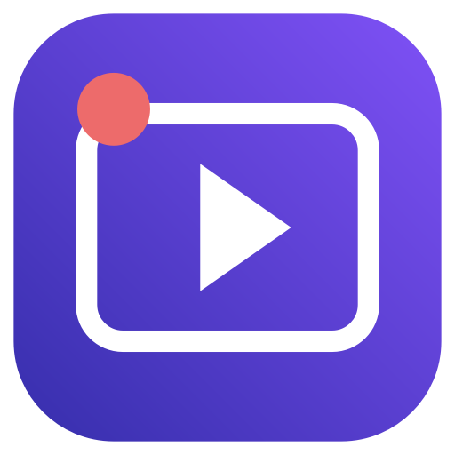
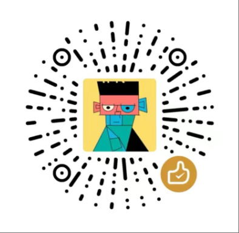

<div align="center">
  
  <h1>录映 · LuYing</h1>
  <p>免费的 macOS 录屏与视频美化工具。</p>
  <p>by <a href="https://zlbigger.com">zlbigger.com</a></p>
  <p>本地录制 · 点击自动缩放 · 字幕 · 无水印导出</p>
  <p><a href="https://github.com/zlbigger/luying/releases/latest">下载安装包</a> · <a href="docs/USAGE.md">使用说明</a> · <a href="https://github.com/zlbigger/luying/issues">反馈问题</a></p>
</div>

录映是一个独立实现、采用 MIT 协议开源的 macOS 应用。无需账号、订阅或付费 API，所有已实现功能均免费开放。录制和媒体处理在本机完成。

**当前为早期版本 v0.3.7**，适合试用和反馈。它不是 Screen Studio 的官方版本，也没有与原版完整功能及质量等价的承诺。

## 功能

| 功能 | 支持情况 |
| --- | --- |
| 显示器、窗口录制 | 按固定显示器／窗口 ID 选择，预览后明确确认并锁定目标 |
| 区域录制 | 选择显示器后设置区域坐标与尺寸 |
| 系统声音、麦克风 | 系统声音录制；macOS 15+ 支持独立麦克风音轨，导出时混音 |
| 摄像头 | 录前实时预览、录制时浮窗显示状态；独立保存，在效果预览和导出时叠加 |
| 暂停与继续 | 屏幕、系统声音、麦克风与摄像头使用统一时间基准，支持同步暂停 |
| 点击自动缩放 | 平滑缩放，合并附近点击；可编辑时段、焦点和倍率，导入视频可手动添加 |
| 鼠标与点击提示 | 可隐藏原始鼠标，使用合成大圆点和点击提示环 |
| 裁剪与变速 | 可视化音频波形、拖动裁剪、多段删除、撤销／重做；界面支持 0.5×、1×、1.5×、2× |
| 画布与背景 | 默认原始尺寸；可选横屏、竖屏、方形、4:3；渐变或图片背景、边距、圆角、阴影 |
| 音频处理 | 普通 FFT 降噪、背景音乐循环与混音 |
| 字幕 | 导入 SRT；Apple 本机语音识别生成字幕，取决于系统语言资源 |
| 效果预览／放大播放 | 本地生成最多 8 秒的效果预览；默认播放器显示原素材；支持独立大窗口播放，可手动切换全屏 |
| 项目保存 | 手动保存项目；自动保存编辑参数，重启恢复上次编辑，不复制素材 |
| 导出 | 无水印 MP4／GIF；宽度 1280～3840 px；百分比、预计剩余时间、取消、重试 |
| 便捷操作 | 录前麦克风音量检查、录制时收起工作台与菜单栏控制、导出后复制文件 |
| 录制保护 | 权限状态、启动／保存互斥、磁盘空间检查、中断时尝试保存素材、任务期间退出保护 |

真实显示器、窗口录制和暂停／继续已在开发机器验证；完整安装包在不含外部工具的 PATH 下通过 MP4／GIF、字幕、摄像头叠加、导出取消和目标文件保护测试；摄像头暂停编码用合成帧验证。视频合成、双音轨混音与中英文字幕烧录用合成样本验证。实际摄像头、各麦克风设备和语音识别质量仍需更多设备测试。

## 安装

**支持：Apple Silicon（M1 或更新），macOS 14+。麦克风录制需要 macOS 15+。Intel 暂无安装包。**

1. 在 [Releases](https://github.com/zlbigger/luying/releases/latest) 下载 `LuYing-v0.3.7-macos-arm64.zip`。
2. 解压，将 `录映.app` 拖入「应用程序」。只保留这一份应用，避免 Spotlight 出现重复项。
3. 打开「录映」，选择「显示器／窗口／区域」，点击「选择显示器…」或「选择窗口…」，核对所选来源的预览，点击「确认录制此来源」，再开始录制。

**完整版安装包已内含 Python 导出运行时、FFmpeg / FFprobe 和预编译字幕程序，用户无需安装 Homebrew 或开发工具。**安装包尚无 Apple Developer ID 签名与公证，使用本地临时签名。若 Gatekeeper 阻止首次打开，请在「系统设置 → 隐私与安全性」使用系统提供的「仍要打开」流程。无需关闭系统安全保护。

麦克风、摄像头与语音识别在启用相应功能时分别请求授权。选择来源需要系统录屏权限；应用按固定对象 ID 录制，不依赖鼠标或共享按钮所在屏幕。

## 开始使用

- 录制文件与同名鼠标轨迹 JSON 保存到 `~/Movies/OpenScreenStudio/`。
- 修改裁剪、画幅、背景等参数，点击「效果预览」检查，或直接导出。
- 选择背景图片、音乐或字幕时，请使用你有权使用的素材。
- GIF 不支持音频。本机字幕识别不会回退到云端，语言资源不可用时会显示原因。
- `.ossproject` 只保存路径和参数，移动／删除原素材会使项目无法恢复。

详细操作见 [使用说明](docs/USAGE.md)。

## 从源码构建

```bash
git clone https://github.com/zlbigger/luying.git
cd luying
./build.sh
```

构建者需要 Apple Silicon Mac、Command Line Tools 与 Python 3。首次构建会下载校验过的 FFmpeg 源码、建立 Python 虚拟环境并安装 PyInstaller，编译耗时数分钟。终端回归测试还需单独安装含 libx264 的 FFmpeg；这些均不是安装包用户的依赖。构建脚本会在临时目录编译、签名，并生成 `LuYing.zip`，不会在仓库里留下第二份可被 Spotlight 搜索到的 `.app`。

运行合成媒体回归检查：`./scripts/smoke-test.sh`。摄像头暂停时间基准检查：`./scripts/test-capture-timing.sh`。多段剪辑检查：`python3 scripts/test-montage.py /path/to/录映.app`。完整安装包检查：`python3 scripts/test-package.py /path/to/录映.app`。

本地导出也可以直接运行：

```bash
python3 exporter.py input.mov output.mp4 \
  --mouse input.json --width 1920 --aspect 16:9 \
  --padding 80 --zoom 1.65 --cursor-size 0 --denoise
```

所有选项：`python3 exporter.py --help`。

## 当前限制

- 尚未实现 iPhone/iPad 直接录制、按键可视化、静音自动删除、多轨重排时间线和云端分享。
- 普通 FFT 音频降噪不等于 AI 降噪；尚无 AI 摄像头增强与完整色彩调整。
- 合成鼠标是圆点；原始鼠标已烘焙到视频中，无法在后期无损移除。
- 自动缩放依赖同名 JSON 轨迹；普通导入视频可手动添加缩放场景。当前最多使用 80 个点击，轨迹会抽样至不超过 800 条。
- 尚未做跨设备／长时间录制的完整兼容性测试。欢迎带系统版本与复现步骤提交 Issue，避免上传敏感录屏。

## 技术与许可

SwiftUI + AppKit、ScreenCaptureKit、AVFoundation、Apple Speech、随包 Python 与 FFmpeg。H.264 导出使用 Apple VideoToolbox。源代码及自绘图标采用 [MIT](LICENSE)；随包 FFmpeg 动态库采用 LGPL 2.1+，Python 与其他组件使用各自许可证，见 [第三方组件说明](THIRD_PARTY_NOTICES.md)。Release 同时提供对应 FFmpeg 源码，构建参数公开。

本仓库不包含其他商业应用的代码、二进制、模型、资源或用户录制文件。

## 支持作者

by [zlbigger.com](https://zlbigger.com) · 开源地址：[github.com/zlbigger/luying](https://github.com/zlbigger/luying)

打赏完全自愿，所有已实现功能均免费开放。软件「关于录映 · 支持作者」中可查看打赏码。



[打开打赏码](https://www.praybuddha.com/generated/diamond-sutra-immersive/reward-qr.png)

录制期间支持全局快捷键：**⌘⇧P** 暂停／继续，**⌘⇧S** 停止并保存。切换到其他软件仍可使用，停止后自动释放；不需要辅助功能权限。若提示按键被占用，请点击菜单栏录制计时器操作。
